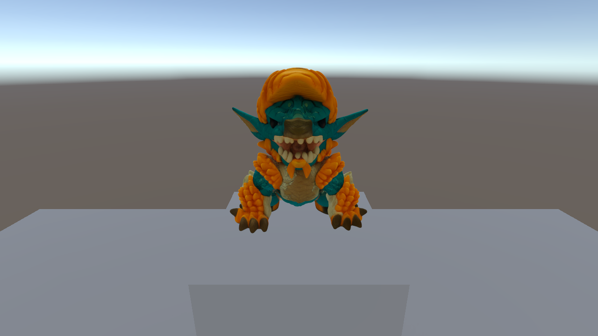

# GS Starter: je splat in Unity

Startproject voor de gastles Gaussian Splatting (Experimental XR, Howest AI Lab).
Je splat als visual, de mesh uit notebook 3 als collider, en ballen om ertegen te gooien.



## Wat je nodig hebt

- **Unity 6000.6.5f1** (getest; minimaal 6000.3, de splat-plugin vraagt dat).
- Voor de Quest: de module **Android Build Support** (met OpenJDK en Android SDK/NDK).
- Een GPU met **DirectX 12 of Vulkan**. Met DirectX 11 rendert de splat niet.

## Openen

1. Open de map `GS-Unity-Starter` in Unity Hub.
2. Open de scène `Assets/Scenes/GSStarter.unity`.
3. Druk op **Play**.

| Zonder headset | |
|---|---|
| Rondkijken | rechtermuisknop ingedrukt + muis |
| Lopen | W A S D, Q en E voor omlaag en omhoog |
| Bal gooien | linkermuisknop of spatie |

Op de Quest gooi je met de **trigger** van je rechtercontroller.

## Je eigen splat

Uit notebook 3 (map `vergelijking/`) heb je twee bestanden die bij elkaar horen:
`*_splat.ply` en `*_collider.obj`.

1. Menu **GS Starter → 3. Mijn splat importeren…**
2. Kies eerst je `*_splat.ply`, daarna je `*_collider.obj` (of annuleer: dan zonder collider).
3. Je splat staat op de tafel, met de collider eronder in hetzelfde assenstelsel.
4. Play, en gooi ballen.

Staat hij ondersteboven? **GS Starter → Splat ondersteboven draaien.** Kijkt hij de verkeerde
kant op? Draai het object rond Y in de Inspector.

Een reconstructie is groot (vloer, tafel, kamer). Knip je object eerst uit in notebook 3
(`CROP`), of in SuperSplat, anders sta je midden in een splat van de hele ruimte.

## Op de Quest

- **Snel bekijken:** open splat.ai-lab.dev in de Quest Browser en vul je code in.
- **Als app (demo):** **GS Starter → Build voor de Quest (APK)** maakt `Builds/GSStarter.apk`.
  Installeren met `adb install -r Builds/GSStarter.apk` (ontwikkelaarsmodus aan op de Quest),
  of met Meta Quest Developer Hub.

Budget: houd het rond **300.000 Gaussians** voor de hele scène (zie notebook 2).

## Wat er in het project zit

| Pad | Wat |
|---|---|
| `Packages/net.kleinbeck.gaussians` | de VR-fork van de splat-plugin ([ninjamode/Unity-VR-Gaussian-Splatting](https://github.com/ninjamode/Unity-VR-Gaussian-Splatting)), ingebed met één fix voor Unity 6000.6 (zie `GS-STARTER-PATCH.md`) |
| `Assets/GSStarter/Runtime` | `BallLauncher` (ballen gooien), `DesktopCamera` (rondkijken zonder headset) |
| `Assets/GSStarter/Editor/StarterSetup.cs` | het menu **GS Starter**: project instellen, scène opbouwen, splat importeren |
| `Assets/GSStarter/Editor/StarterBuild.cs` | APK bouwen voor de Quest |
| `Assets/GSStarter/Editor/StarterScreenshot.cs` | controles zonder Editor-venster: screenshot en een collidertest |
| `SampleData/` | de Zinogre (splat + collider uit notebook 3), buiten `Assets` zodat Unity hem niet zelf importeert |

### Het project opnieuw opbouwen

Alles is reproduceerbaar vanuit de commandolijn (Unity mag niet openstaan):

```
Unity.exe -batchmode -projectPath . -executeMethod StarterSetup.BatchSetup -quit -logFile -
Unity.exe -batchmode -projectPath . -executeMethod StarterScreenshot.BatchColliderTest -quit -logFile -
Unity.exe -batchmode -buildTarget Android -projectPath . -executeMethod StarterBuild.BuildQuest -quit -logFile -
```

`StarterSetup.BatchSetup` doet:

- **Player settings:**
  - Windows draait op D3D12 of Vulkan.
  - Android (Quest): Vulkan, ARM64, IL2CPP, API 32+.
- **URP:** de *Gaussians*-feature in `PC_Renderer` en `Mobile_Renderer`.
- **XR:** OpenXR alleen voor Android, met de Meta Quest-feature en de Touch-controllerprofielen.
  Op de laptop blijft Play-modus dus een gewone camera.
- **Scène:** XR-rig, vloer, tafel, ballenwerper en de Zinogre met collider.

## Goed om te weten

- **Gespiegeld.** De splat-plugin neemt de coördinaten uit de PLY ongewijzigd over, terwijl
  Unity linkshandig is: je splat staat dus gespiegeld. Bij een beeldje zie je dat niet, bij
  tekst wel. De collider wordt met dezelfde conventie ingelezen (niet met Unity's
  OBJ-importer, die de X-as omdraait), zodat hij precies over de splat valt.
- **Binnenstebuiten colliders** (normalen naar binnen) worden bij het importeren automatisch
  omgedraaid; anders rolt een bal er dwars door.
- Meerdere splats in één scène? Voeg een **Gaussians Group**-component toe, anders sorteren
  ze los van elkaar.
